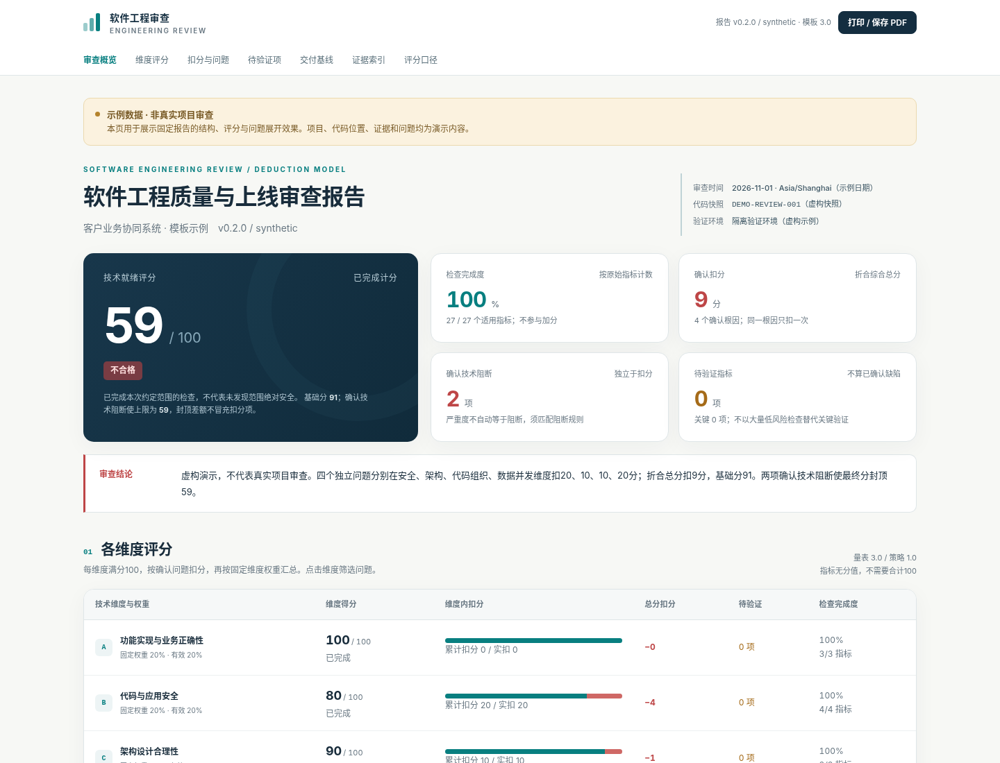

# Production Readiness Audit

**A working demo is not a production-ready system.**

[简体中文](README.zh-CN.md) · [Quick start](docs/QUICKSTART.md) · [Extend the rules](docs/EXTENDING_RULES.md) · [Validation](docs/VALIDATION.md)

An evidence-based agent skill and offline HTML reporting toolkit for reviewing existing software before production: bugs, security vulnerabilities, architecture, duplicated business rules, concurrency and operational gaps. Diagnose first; do not silently add features, rewrite the app or deploy it.

**v0.2.0 — fixed dimension weights; deductions within each dimension.** Criteria have no point allocations. Add a criterion without redistributing the other criteria's weights.

## Install

Use the [skills CLI](https://github.com/vercel-labs/skills) to install the skill into your agent host (Claude Code, Codex, Cursor, OpenCode and 80+ more). Run it **in the project you want to review**:

```sh
# Claude Code
npx skills add WayJ/production-readiness-audit --skill production-readiness-audit -a claude-code
```

For other hosts, replace `-a claude-code` with their name — `-a codex`, `-a cursor` — or use `-a '*'` for every detected host:

```sh
npx skills add WayJ/production-readiness-audit --skill production-readiness-audit -a '*'
```

The skill lands in the project's `.claude/skills/production-readiness-audit/` (or your host's equivalent) and applies to that project only; add `-g` to make it available across projects. Requires Node.js 22.20 or later.

Windows PowerShell / Command Prompt use the same command:

```powershell
npx skills add WayJ/production-readiness-audit --skill production-readiness-audit -a claude-code
```

Without the CLI, copy the whole `skills/production-readiness-audit/` directory into the skill directory your host supports. `python scripts/install_skill.py --target <directory>` does the same copy: it changes no host settings and refuses to overwrite an existing directory.

## Invoke

After installing, open a **new agent session in the same project** and ask for the review in plain language. Copy any of these three:

```text
Use production-readiness-audit to review this project for production readiness
```

```text
Use production-readiness-audit to review this project, security and concurrency dimensions only
```

```text
Use production-readiness-audit to review this project and write the report to .audit/review.html
```

The agent follows [SKILL.md](skills/production-readiness-audit/SKILL.md) to inspect the code and record evidence, then calls this repository's CLI to validate, score and render the HTML report. The agent performs the review; the CLI does not scan projects by itself.



## What this does—and does not do

Your agent or reviewer inspects the actual project and collects evidence. This standard-library Python CLI validates the review records, calculates deductions and renders a self-contained HTML report. It is **not an automatic vulnerability scanner**, a certification service or a release authorization. Rendering a sample is not a review of your source code.

The repository includes the self-contained skill, 27 extensible criteria, scoring policy, schema generation, synthetic examples, bilingual landing pages, tests, an MIT license and GitHub Actions configurations. The report interface is Chinese; the README and site are bilingual. No API key, database, Node.js or Python package installation is required for the core CLI.

## Try the report

Python 3.10+ is required. In the extracted repository root:

```sh
python scripts/review.py render --input examples/audit.demo.json --output reports/demo.html
```

Windows PowerShell / Command Prompt:

```powershell
py -3 scripts/review.py render --input examples/audit.demo.json --output reports/demo.html
```

Open `reports/demo.html` in a modern browser. The sample has a raw score of **91**, **9** weighted deduction points and **2** confirmed blockers, resulting in **59** after the cap. All names, evidence, locations and findings are fictional. `site/report-partial.html` illustrates an incomplete review: a provisional upper bound, not a final score.

## Review a real project

```sh
python scripts/review.py init --project "My application" --snapshot "actual-commit-or-package-hash" --output review-data/audit.json
python scripts/review.py validate --input review-data/audit.json
python scripts/review.py render --input review-data/audit.json --output reports/review.html --json-output reports/review.scored.json
```

The initial file is **entirely unreviewed**. Supply the actual baseline, checks, evidence and findings before producing a meaningful review. Read [SKILL.md](skills/production-readiness-audit/SKILL.md) for the authorized review procedure. Failed checks need confirmed findings and shared evidence. Passing checks also require evidence. Unknowns are not defects; an unchecked dimension is not awarded 100.

For day-to-day use, prefer the **Invoke** section above and let the agent run the whole flow; these commands are for manual, step-by-step execution and troubleshooting.

## Scoring

| Dimension | Nominal weight |
|---|---:|
| Functional and business correctness | 20% |
| Code and application security | 20% |
| Architecture suitability | 10% |
| Code organization and maintainability | 10% |
| Data and concurrency correctness | 15% |
| Reliability and failure handling | 10% |
| Performance and resource control | 5% |
| Build, deployment and change safety | 5% |
| Observability and recovery | 5% |

Each dimension starts at 100 for calculation and deducts confirmed findings: low **3**, medium **10**, high **20**, critical **40**. It cannot fall below zero. These are project policy choices, not an industry certification standard.

`dimension score = max(0, 100 − sum of confirmed finding penalties)`

`overall raw score = sum(dimension score × effective dimension weight)`

A root cause is charged once even if it affects several checks. Independent root causes are charged separately even under the same criterion. Duplicate root-cause records are rejected, not silently double-charged. A valid confirmed blocker caps the overall score at **59**; the cap is separate from deductions. Severity and blocker status are separate decisions with required explanations.

Grades are ≥80 good, ≥60 acceptable, and <60 inadequate. Incomplete reviews have **no final score**; they show known deductions and a provisional upper bound. Coverage counts fully reviewed base criteria and does not award points. Fully unreviewed reports are unscored. Individual NA criteria do not change dimension weights; only a wholly inapplicable dimension is excluded with explicit effective-weight normalization. Reasons are required; missing evidence is not NA.

Owners, signatures, approvals, document counts, code provenance and framework preferences do not affect the score.

## One source of rules

- `skills/production-readiness-audit/assets/scoring-rubric.json`: dimension weights and unweighted criterion definitions.
- `skills/production-readiness-audit/assets/scoring-policy.json`: severity penalties, grade thresholds and blocker rules.

After editing and versioning the source definitions:

```sh
python scripts/review.py sync-rules
python scripts/review.py sync-rules --check
```

This regenerates the editor JSON Schema, all-unknown starter file and criterion reference. The runtime reads those same sources, so criterion IDs are not hard-coded in the scorer or report. See [extension instructions](docs/EXTENDING_RULES.md). Existing reviews and fictional test fixtures are intentionally not marked passed or silently migrated.

Each generated report includes the exact rule snapshots and SHA-256 fingerprints. Use `--rubric frozen-rubric.json --policy frozen-policy.json` with `init`, `validate`, `score` or `render` to reproduce a review under saved rules. Keep old reports unchanged.

## Development and distribution

```sh
python scripts/review.py sync-rules --check
python -m unittest discover -s tests -v
python scripts/build_site.py
python scripts/verify_repo.py
python scripts/package_release.py
```

The release tool creates a complete project ZIP, a standalone skill ZIP and `SHA256SUMS`, using an explicit file allowlist. It does not upload, tag or publish anything. Browser tests are optional and require Playwright plus Chromium; core operation and unit tests do not.

Cross-platform commands and a Windows/macOS/Linux CI matrix are provided. **A configured CI matrix is not proof those platforms have run.** See [validation](docs/VALIDATION.md) for what was actually executed.

## GitHub Pages and safe publication

The bilingual static site is in `site/`. Preview it with `python -m http.server 8000 --directory site --bind 127.0.0.1`. The Pages workflow is gated by repository variable `ENABLE_PAGES=true`; select GitHub Actions as the Pages source. Only two allowlisted fictional examples are built. Real reports and inputs belong in ignored private directories, never under `site/` or `examples/`.

The repository is prepared for `WayJ/production-readiness-audit`; this archive does not establish that the remote repository, CI, Pages or a Release exists. Follow the [release checklist](docs/RELEASE_CHECKLIST.md). Do not upload customer code, evidence, credentials or reports to a public issue or branch.

## Project links

[Contributing](CONTRIBUTING.md) · [Security](SECURITY.md) · [Support](SUPPORT.md) · [Migration](docs/MIGRATION.md) · [Changelog](CHANGELOG.md) · [MIT license](LICENSE)
