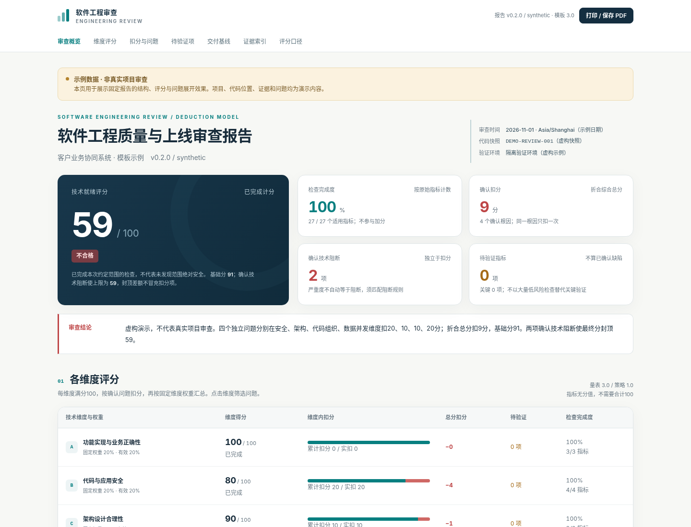

# Production Readiness Audit

**演示能跑，不等于可以上线。**

[English](README.md) · [快速开始](docs/QUICKSTART.md) · [新增指标](docs/EXTENDING_RULES.md) · [验收记录](docs/VALIDATION.md)

面向现有软件、AI 辅助开发项目和 Vibe Coding 原型的上线前技术诊断 Skill 与 HTML 报告工具。重点检查漏洞、Bug、架构、重复业务规则、并发与生产运行缺口。只诊断，不扩产品功能、不擅自重构或发布。

**v0.2.0 已改为：维度固定权重，维度内部满分扣分。指标不分配分数，新增指标不用重新凑权重。**

## 安装

把完整 Skill 复制到宿主 Agent 支持的技能目录：

```sh
python scripts/install_skill.py --target ~/.claude/skills
```

Windows PowerShell / CMD：

```powershell
py -3 scripts/install_skill.py --target "C:\Users\You\.claude\skills"
```

安装器只复制白名单内的 Skill 文件，不改宿主设置，也不会覆盖已有目录（会直接报错，需要先改名或删除旧目录）。不同宿主的技能目录不同，请按你的宿主文档替换 `--target`；能否被自动发现需在宿主中验证。

## 调用

装好后，在**要审查的项目目录**新开一个 Agent 会话，用自然语言下达任务。下面三条可以直接复制：

```text
用 production-readiness-audit 审查这个项目的上线就绪情况
```

```text
用 production-readiness-audit 审查这个项目，只看安全和并发两个维度
```

```text
用 production-readiness-audit 审查这个项目，报告输出到 .audit/review.html
```

Agent 会按 [SKILL.md](skills/production-readiness-audit/SKILL.md) 实际检查代码、记录证据，再调用本仓库的 CLI 校验、计分并生成 HTML 报告。审查由 Agent 完成，CLI 不自动扫描项目。



## 能做什么

Agent / 审查者实际检查项目、取得证据；Python 工具校验审查记录、计算分数、生成固定 HTML。它不是自动扫描所有项目的漏洞扫描器，不保证发现所有问题，也不提供上线许可。成功生成报告不表示已经审查代码。

完整工程包含独立 Skill、27 个可扩展指标、扣分策略、自动生成的 Schema 与检查说明、虚构示例、中英文 README 和官网、自动测试、MIT 许可证及 GitHub 工作流。报告界面当前为中文。

核心工具只使用 Python 3.10+ 标准库，无须数据库、API Key、Node.js 或额外 Python 包。Windows、macOS、Linux 提供相应命令；实际测试范围见验收记录。

## 先体验固定报告

在解压后的项目根目录运行：

```sh
python scripts/review.py render --input examples/audit.demo.json --output reports/demo.html
```

Windows PowerShell / CMD：

```powershell
py -3 scripts/review.py render --input examples/audit.demo.json --output reports/demo.html
```

用浏览器打开 `reports/demo.html`。完整示例基础分 **91**、确认加权扣分 **9**，存在两项确认技术阻断，最终封顶 **59**。所有项目、位置、问题和证据均为虚构。`site/report-partial.html` 展示未完成检查时的暂评上限，而不是最终得分。

## 用于真实项目

```sh
python scripts/review.py init --project "客户项目" --snapshot "真实提交或包哈希" --output review-data/audit.json
python scripts/review.py validate --input review-data/audit.json
python scripts/review.py render --input review-data/audit.json --output reports/review.html --json-output reports/review.scored.json
```

初始化数据全部是 `unknown`，不会默认通过。先让具备项目访问能力的 Agent 按 [SKILL.md](skills/production-readiness-audit/SKILL.md) 检查，再填写真实基线、证据与问题。不从全通过样例改名制造真实结论。日常使用推荐直接用上面的「调用」方式让 Agent 走完整流程；这套命令用于手动逐步执行或排查问题。

## 评分规则

| 维度 | 固定权重 |
|---|---:|
| 功能实现与业务正确性 | 20% |
| 代码与应用安全 | 20% |
| 架构设计合理性 | 10% |
| 代码组织与可维护性 | 10% |
| 数据与并发正确性 | 15% |
| 稳定性与异常处理 | 10% |
| 性能与资源控制 | 5% |
| 构建部署与版本变更 | 5% |
| 故障发现与恢复能力 | 5% |

每个维度按100分起算，确认问题按轻微3、中等10、严重20、致命40扣分，最低0分。这是本项目可配置的初始策略，不是行业标准或认证分值。

```text
维度得分 = max(0, 100 − 本维度确认问题扣分之和)
综合基础分 = Σ(维度得分 × 有效维度权重)
```

同一根因合并成一个问题，即使命中多个指标也只在主维度扣一次；多个独立根因即使命中同一指标，也分别扣分。重复根因记录会被拒绝，需先合并。

80–100良好，60至不足80合格，低于60不合格。确认技术阻断独立封顶59，不把封顶差额编成新扣分。严重程度、关键验证与上线阻断彼此区分。

未完成检查不给最终分，只显示确认扣分和暂评上限。完全未检查显示“未评估”，不默认100分。完成度按原始指标计数，拆成更多子检查不会提高完成度。关键未知必须单独展示；完成度不参与加分。

单个指标不适用不改变维度权重；仅整个维度确实不适用时剔除该维度，并在报告公开重新归一化的有效权重。不适用必须有基线依据，不能因为缺证据而排除。

负责人、审批、签字、交接、文档数量、代码是否由AI编写和架构偏好不计分。

## 指标与策略分开维护

```text
skills/production-readiness-audit/assets/
  scoring-rubric.json       维度权重与无分值指标
  scoring-policy.json       扣分档位、等级、阻断规则
  audit.schema.json         自动生成，不手改
  audit.blank.json          自动生成，全待验证
  report.template.html      固定报告模板
```

修改源定义并升级规则版本，然后执行：

```sh
python scripts/review.py sync-rules
python scripts/review.py sync-rules --check
```

自动同步 Schema、空白审查数据和指标说明，不需要改评分算法或报告页面。新增指标教程见 [EXTENDING_RULES.md](docs/EXTENDING_RULES.md)。历史审查与示例不自动写成通过；历史报告保持原样。

每份报告内嵌规则快照和SHA-256。可通过 `--rubric frozen-rubric.json --policy frozen-policy.json` 使用保存的规则复算。

## 验证与打包

```sh
python scripts/review.py sync-rules --check
python -m unittest discover -s tests -v
python scripts/build_site.py
python scripts/verify_repo.py
python scripts/package_release.py
```

打包器按明确文件白名单生成完整工程 ZIP、独立 Skill ZIP 和 `SHA256SUMS`，不包含真实审查、缓存或密钥，不执行上传。可选浏览器测试需要 Playwright 与 Chromium；核心工具和单元测试不依赖它们。

## 官网与GitHub发布

`site/` 是中英文静态官网，可用 `python -m http.server 8000 --directory site --bind 127.0.0.1` 本地预览。Pages工作流需配置 `ENABLE_PAGES=true`，并在仓库Settings中选择GitHub Actions作为Pages来源。仅构建两份白名单虚构示例。

目标仓库预设为 `WayJ/production-readiness-audit`。**此包不表示远程仓库、CI、Pages或Release已经发布。** 操作步骤见[首次发布清单](docs/RELEASE_CHECKLIST.md)。真实报告应保存在被忽略的私有目录，不要放入官网或公开Issue。

[贡献说明](CONTRIBUTING.md) · [安全政策](SECURITY.md) · [迁移说明](docs/MIGRATION.md) · [更新记录](CHANGELOG.md) · [MIT许可证](LICENSE)
